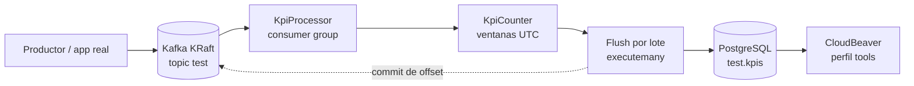

# kpi-datapipeline

Pipeline de streaming que consume eventos JSON desde **Apache Kafka**, calcula
KPIs por minuto, hora y día, y los persiste en **PostgreSQL** con contadores
acumulativos.

[](https://python.org)
[](https://kafka.apache.org/)
[](https://www.postgresql.org/)
[](https://www.docker.com/)
[](https://github.com/bi0punk/kpi-datapipeline/pkgs/container/kpi-datapipeline)
[](LICENSE)

## Qué resuelve

Cada evento trae un `@timestamp` (epoch). El procesador lo convierte a ventanas
**UTC** y hace upsert de tres contadores:

| KPI | Ventana | Ejemplo |
|---|---|---|
| `REQUEST_X_MINUTE` | minuto | `2026-11-11-18-42` |
| `REQUEST_X_HOUR` | hora | `2026-11-11-18` |
| `REQUEST_X_DAY` | día | `2026-11-11` |

El consumidor agrupa escrituras, confirma offsets **después** de persistir el
lote y sobrevive a caídas de PostgreSQL sin perder eventos.

## Arquitectura



- **Kafka en KRaft**: sin Zookeeper; `kafka-init` crea el tópico una vez.
- **Batching**: `KPI_FLUSH_MAX_ROWS` o `KPI_FLUSH_INTERVAL`, lo que ocurra antes.
- **At-least-once**: `enable_auto_commit=False`; si el flush falla se conservan
  las filas y no se commitea el offset.
- **UTC**: las claves no dependen del timezone del host.

## Stack

| Componente | Tecnología |
|---|---|
| Consumo | Python 3.11+, `kafka-python` |
| Broker | Apache Kafka 3.9 (KRaft) |
| DB | PostgreSQL 16 |
| Demo | `scripts/produce_demo.py` |
| UI DB (opcional) | CloudBeaver (`--profile tools`) |
| Orquestación | Docker Compose |

## Inicio rápido

```bash
git clone https://github.com/bi0punk/kpi-datapipeline.git
cd kpi-datapipeline
cp .env.example .env
docker compose up -d --build

# 200 eventos de ejemplo
docker compose --profile demo run --rm producer

# consultar los KPIs
docker compose exec postgres psql -U postgres -d postgresdb \
  -c "SELECT * FROM test.kpis ORDER BY vcount DESC LIMIT 10;"
```

Salida esperada:

```
   kpi_key      |     kpi_value      | vcount
----------------+--------------------+--------
 REQUEST_X_MINUTE | 2026-11-11-18-42 |     14
 REQUEST_X_HOUR   | 2026-11-11-18    |    200
 REQUEST_X_DAY    | 2026-11-11       |    200
```

## Servicios

| Servicio | Puerto | Perfil | Descripción |
|---|---|---|---|
| `kafka` | 9092 / 29092 | — | Broker KRaft (29092 para el host) |
| `kafka-init` | — | — | Crea el tópico si no existe |
| `postgres` | 5432 | — | Almacenamiento de KPIs |
| `processor` | — | — | Consumer del pipeline |
| `producer` | — | `demo` | Genera eventos de ejemplo |
| `cloudbeaver` | 8080 | `tools` | Cliente web de base de datos |

## Configuración

| Variable | Default | Descripción |
|---|---|---|
| `DB_NAME` | `postgresdb` | Base de datos |
| `DB_HOST` | `127.0.0.1` | Host de PostgreSQL |
| `DB_USER` | `postgres` | Usuario |
| `DB_PASSWORD` | `postgres` | Password |
| `DB_PORT` | `5432` | Puerto |
| `DB_TABLE` | `test.kpis` | Tabla destino (schema.tabla) |
| `KAFKA_BOOTSTRAP_SERVERS` | `127.0.0.1:9092` | Brokers |
| `KAFKA_TOPIC` | `test` | Tópico |
| `KAFKA_GROUP` | `kpi-processor` | Consumer group |
| `KPI_FLUSH_INTERVAL` | `2.0` | Segundos máximos entre flushes |
| `KPI_FLUSH_MAX_ROWS` | `500` | Filas por flush |
| `CB_ADMIN_PASSWORD` | `admin123` | Admin de CloudBeaver |

Detalle en [docs/CONFIGURATION.md](docs/CONFIGURATION.md).

## Modelo de datos

`db/init.sql` crea el esquema y la tabla al inicializar el volumen:

```sql
CREATE SCHEMA IF NOT EXISTS test;

CREATE TABLE IF NOT EXISTS test.kpis (
  kpi_key   TEXT   NOT NULL,
  kpi_value TEXT   NOT NULL,
  vcount    BIGINT NOT NULL DEFAULT 0,
  PRIMARY KEY (kpi_key, kpi_value)
);
```

## Calidad

```bash
uv venv .venv --python 3.12
uv pip install -e ".[dev]"

.venv/bin/ruff check .
.venv/bin/mypy app.py kpi.py scripts
.venv/bin/pytest -q --cov=app --cov=kpi --cov=scripts --cov-fail-under=65
.venv/bin/pip-audit --skip-editable
```

**27 tests**, cobertura **74 %** (gate 65 %).

GitHub solo aloja el código. La integración continua y el despliegue se
ejecutan en GitLab/entorno local; los workflows de `.github/` están
deshabilitados en GitHub. La validación es la de la sección anterior.

## Estructura

```
kpi-datapipeline/
├── app.py                  # Config, KpiProcessor y loop Kafka
├── kpi.py                  # Ventanas UTC y contador (puro)
├── scripts/produce_demo.py # Generador de eventos
├── db/init.sql             # Esquema test.kpis
├── tests/                  # 27 tests (sin Kafka/Postgres reales)
├── docs/                   # configuración y despliegue
├── Dockerfile
├── docker-compose.yml      # KRaft + Postgres + processor + perfiles
└── pyproject.toml
```

## Seguridad

- Credenciales por entorno; `.env` está en `.gitignore`.
- Los contenedores corren sin root (uid 10001) y con `no-new-privileges`.
- Kafka usa PLAINTEXT: es un entorno de desarrollo. En producción configura
  SASL_SSL y no publiques 9092/5432 a internet.
- `DB_TABLE` viene del entorno, no de los mensajes (no hay SQL injection).

## Roadmap

- [x] Kafka → PostgreSQL con KPIs por minuto/hora/día
- [x] Batching, UTC y at-least-once
- [ ] Ventanas deslizantes y percentiles
- [ ] Exportación a Prometheus/Grafana
- [ ] Alertas por umbral

## Licencia

MIT — ver [LICENSE](LICENSE).
